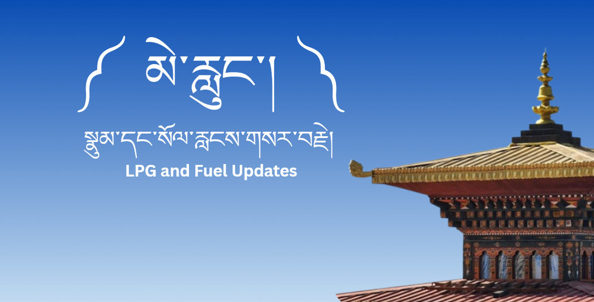

# MeLung

**MeLung** is an Android application designed to improve access to LPG and fuel availability information in Bhutan. It combines official fuel price information, community-reported updates, and an AI assistant to help users make more informed decisions.

### View Presentation Website: https://popscreen.my.canva.site/melung-lpg-and-fuel

## Features

- **Home:** View fuel prices and LPG and fuel availability information.
- **Community Reports:** Submit, save, and retrieve community updates about local availability.
- **Ask MeLung AI:** Get AI-powered assistance through an integrated AI API.
- **Profile & Settings:** Access application settings and profile options.

## Technical Highlights

This project fulfills all four required mobile application criteria:

- **Multiple Screens:** Navigation across several application screens.
- **Data Persistence:** Local database storage for saving and retrieving community reports.
- **External Connectivity:** Integration with external APIs using Kotlin coroutines for asynchronous operations.
- **AI Integration:** An AI-powered assistant for answering user queries.

## Tech Stack

- Kotlin
- Android Studio
- Jetpack Compose
- Room Database
- Supabase
- Gemini API
- Kotlin Coroutines

---

*Developed as a final-year mobile application project.*
